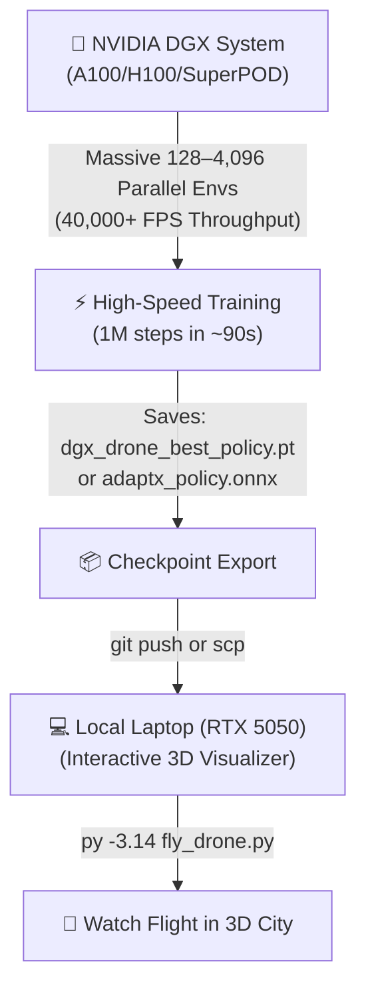

# ⚡ NVIDIA DGX & Isaac Lab Training Guide

This guide explains how to leverage your **NVIDIA DGX Cluster (A100 / H100 / SuperPOD)** to train the ADAPT-X Reinforcement Learning models with massive parallelism, and transfer the learned policies back to your laptop for real-time 3D visualization.

---

## 🏗️ Architecture: Hybrid Cloud / Cluster Workflow



---

## 🚀 Quick Start on NVIDIA DGX

### Step 1: Connect to your DGX Terminal & Clone
```bash
git clone https://github.com/bishtprateek270-hue/ADAPT-X.git
cd ADAPT-X
```

---

### Step 2: Choose Your Training Engine on DGX

#### 🟢 Option A: DGX Spark Heavy Deep RL Phased Trainer (3.3M Parameter Model)
Utilizes **Multi-Head Temporal Transformer** + **512-wide Deep ResNet Actor-Critic** with **BFloat16 Tensor Core** acceleration:
```bash
# 1-Click launcher for heavy model training across all 5 phases:
./run_heavy_dgx_spark.sh all 1.0 32

# Or run with custom scale and parallel workers:
./run_heavy_dgx_spark.sh all 0.5 64
```
* **Architecture:** 4-Head Temporal Transformer ($H=20 \rightarrow \mathbf{z}_t \in \mathbb{R}^{32}$) + Deep ResNet Actor & Critic Trunks (3,304,377 parameters).
* **Performance:** $\sim 2,500\text{ FPS}$ on Blackwell GB10 Tensor Cores with sub-millisecond edge ONNX runtime ($645\ \mu\text{s}$ P50).
* **Output:** Checkpoints in `checkpoints/dgx_spark_heavy/` and deployment models in `deployments/adaptx_heavy_dgx_spark.onnx`.

---

#### 🟢 Option B: DGX Spark Fast Phased Curriculum Trainer
Divided into 5 distinct training curriculum phases with automatic checkpoint chaining:
```bash
# 1-Click launcher for all 5 phases on DGX Spark:
./run_dgx_spark_phases.sh quadruped all

# Or run a specific phase individually:
./run_dgx_spark_phases.sh quadruped 1   # Phase 1: Nominal Locomotion
./run_dgx_spark_phases.sh quadruped 2   # Phase 2: Damage Injection
./run_dgx_spark_phases.sh quadruped 3   # Phase 3: RMA History Encoder
./run_dgx_spark_phases.sh quadruped 4   # Phase 4: Staged Disturbance Curriculum
./run_dgx_spark_phases.sh quadruped 5   # Phase 5: Sim2Real & ONNX Export
```
* **Performance:** **$\sim 4,000 - 15,000\text{ FPS}$** on NVIDIA Grace Blackwell GB10.
* **Output:** Checkpoints saved to `checkpoints/dgx_spark/` and ONNX policy exported to `deployments/adaptx_dgx_spark_policy.onnx`.

---

#### 🟣 Option B: NVIDIA Isaac Lab & Isaac Sim Phased RL Suite
If your cluster runs **NVIDIA Omniverse / Isaac Sim & Isaac Lab**:
```bash
# Launch with Isaac Lab launcher script:
./isaac_lab/isaac_lab_phases.sh quadruped all 4096

# Or run directly with Isaac Lab Python wrapper:
./isaaclab.sh -p isaac_lab/train_isaac_lab_phases.py --phase all --robot quadruped --num_envs 4096
```
* **Performance:** **$\sim 45,000+\text{ FPS}$** using NVIDIA PhysX 5 GPU Tensor Streams.
* **Output:** Direct export to `deployments/adaptx_isaac_policy.onnx`.

---

#### 🔵 Option C: Slurm Batch Scheduler (DGX SuperPOD / University Clusters)
If your DGX cluster uses Slurm for job scheduling:
```bash
# Submit batch job:
sbatch submit_slurm_dgx.sh

# Monitor status:
squeue -u $USER
tail -f logs/slurm_dgx_*.log
```

---

## 📥 Step 3: Copy Checkpoint to Your Laptop & Visualize

Once training completes on the DGX node, transfer the lightweight checkpoint file back to your laptop:

### Method 1: Via SCP / SFTP
```bash
# Run on your laptop terminal:
scp user@dgx-server:/path/to/ADAPT-X/checkpoints/dgx_drone_best_policy.pt ./checkpoints/
```

### Method 2: Via Git
On DGX:
```bash
git add checkpoints/dgx_drone_best_policy.pt deployments/*.onnx
git commit -m "feat: Add DGX-trained drone policy checkpoint"
git push origin main
```
On Laptop:
```bash
git pull origin main
```

---

## 🎮 Step 4: Run Interactive 3D Flight on Laptop
On your laptop, launch the 3D City visualizer using the newly trained DGX policy:

```powershell
py -3.14 fly_drone.py
```

Watch the drone glide through the 3D city with rock-solid stability and instant mid-air failure recovery learned on your NVIDIA DGX system!
