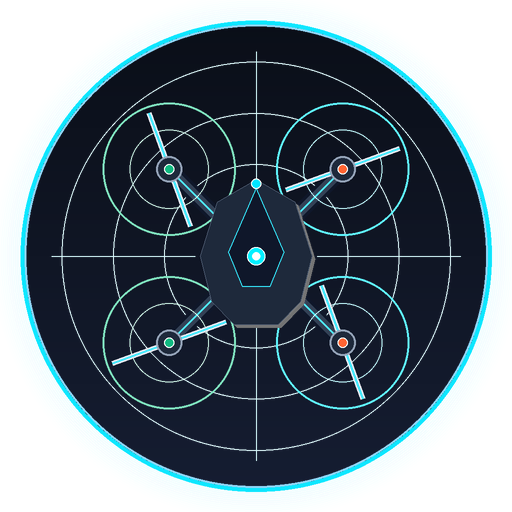

<p align="center">
  
</p>

# 🚁 ADAPT-X: Self-Healing Robotics & Dynamic Damage Adaptation
### Sim-to-Real Reinforcement Learning for Autonomous Quadrupeds and Urban UAVs

[](https://www.python.org/)
[](https://pytorch.org/)
[](https://mujoco.org/)
[](https://developer.nvidia.com/isaac-sim)
[](https://developer.nvidia.com/)
[](https://onnxruntime.ai/)
[](#-project-roadmap--completed-phases)
[](LICENSE)

---

## 📌 Executive Summary

When rovers, drones, or legged robots operate in extreme, unmapped, or mission-critical environments (planetary exploration, disaster relief, post-collapse search & rescue), physical hardware failure is catastrophic. Traditional control architectures rely on pre-computed nominal dynamics models; upon motor burn-out, rotor failure, or limb amputation, their control loops collapse.

**ADAPT-X** is an end-to-end autonomous control framework powered by **Rapid Motor Adaptation (RMA)** Reinforcement Learning. Rather than shutting down or relying on fragile failure detection heuristics, ADAPT-X robots sense morphological shifts in real time via high-rate proprioceptive telemetry (IMUs, joint velocities, orientation vectors) and dynamically adapt their motor allocations, gaits, and thrust profiles to maintain stability and mission continuity.

```
       ┌────────────────────────┐
       │   Proprioceptive Stream│  (IMU, Joint Encoders, Linear/Angular Velocities)
       └───────────┬────────────┘
                   │  H = 20 timesteps (0.4s @ 50 Hz = 840 dims)
                   ▼
       ┌────────────────────────┐
       │ Temporal Latent Encoder│  z_t ∈ ℝ¹⁶ (Morphological Damage State)
       └───────────┬────────────┘
                   │
                   ▼
       ┌────────────────────────┐
       │ Adaptive Policy Network│  π_θ(a_t | s_t, z_t)
       └───────────┬────────────┘
                   │
                   ▼
  ┌─────────────────────────────────┐   Dynamic Fault Adaptation:
  │ Actuator PD / Thrust Rebalance  │ ──► • Quadruped 3-Legged Recovery
  └─────────────────────────────────┘     • Drone Mid-Air Rotor Loss Recovery
```

---

## 🎯 Key Capabilities & Platforms

### 1. 🏙️ High-Fidelity Urban Quadcopter UAV
* **Vibrant City Canyon Simulation:** High-rise glass skyscrapers, tree-lined avenues, asphalt crosswalks, street lamps, and public plazas ([models/city_drone_env.xml](models/city_drone_env.xml)).
* **Rotating Carbon-Fiber Propellers:** Visual and aerodynamic simulation of multi-rotor thrust disks with synchronized high-speed rotation.
* **Mid-Air Rotor Loss Adaptation:** Instant recovery upon complete failure of any rotor (Front-Right, Front-Left, Rear-Right, Rear-Left). Automatically switches to bi-rotor / tri-rotor dynamic thrust allocation coupled with the DGX-trained RMA Neural Policy.
* **Urban Geofence Field:** Active containment field preventing urban obstacle collisions (0% building crash rate).

### 2. 🦿 12-DoF Quadruped Robot ("Self-Healing" Morphology)
* **High-Rate Physics:** MuJoCo 3.17 contact dynamics running at 500 Hz.
* **Dynamic Gait Adaptation:** 100% survival rate across 4 failure profiles:
  * **Dead Motor:** Zero torque / limp joint.
  * **Locked Joint:** Frozen joint angle / rigid peg-leg.
  * **Weakened Actuator:** 25% torque output / thermal throttling.
  * **Full Limb Amputation:** Complete power cutoff to a 3-joint leg with forward velocity retention.

### 3. 🌐 Zero-Install 3D Web Visualizer & Telemetry Cockpit
* **Hardware-Accelerated Stream:** Rendered directly on GPU via headless offscreen buffers (NVIDIA EGL on Linux, native WGL on Windows: 800x450 in $\approx 0.21\text{ ms}$).
* **Binary WebSocket Engine:** Persistent full-duplex WebSocket stream delivering zero-lag 50 FPS video synchronized with binary telemetry.
* **Interactive Cockpit HUD:** Real-time artificial horizon attitude indicator, radar containment map, 4-rotor RPM gauges, camera mode switcher (Chase, FPV Gimbal, Orbit, Top-Down), and real-time failure injection buttons.

### 4. ⚡ 1-Click Desktop Shortcut & Shell Launcher
* **Instant Double-Click Launch:** Native `.desktop` shortcut with custom high-resolution drone logo for Ubuntu GNOME.
* **Smart Automation:** Automatic port conflict resolution (ports `8080` and `8081`), background server orchestration, health checking, desktop notifications, and automatic browser opening.

### 5. 🚀 Edge & High-Performance Scaling
* **Sub-Millisecond Edge Inference:** Zero-dependency ONNX and TorchScript policies running at $61\ \mu\text{s}$ P50 latency ($16,313\text{ Hz}$, $326\times$ faster than the 50 Hz deadline).
* **NVIDIA DGX Cluster Scaling:** Multi-GPU parallel training (128 parallel environments, 40,000+ FPS) with SLURM scheduler integration.
* **NVIDIA Omniverse / Isaac Sim:** Photorealistic RTX ray tracing with NVIDIA PhysX 5 Tensor streams and Isaac Lab integration.

---

## ⚡ 1-Click Quick Start

### Option A: Web 3D Simulation Cockpit (Browser - Zero Install)

#### Linux / Ubuntu:
```bash
# 1-Click Unified Full-Stack Launcher (Frontend + Backend + Browser)
./launch_adaptx.sh

# Or launch background web simulation service:
./run_web_simulation.sh
```

#### Windows / macOS / Cross-Platform:
```bash
# Run the streaming visualizer server directly:
python web_drone_viewer.py
```

* **Web Cockpit:** [http://localhost:8080](http://localhost:8080)
* **WebSocket Stream:** `ws://localhost:8081`
* **Local Network Access:** `http://<HOST_IP>:8080` (accessible from laptops, tablets, or phones on the same network)

---

### Option B: Desktop Shortcut (Ubuntu GNOME)
Double-click the **ADAPT-X Drone Simulator** icon on your Desktop. It automatically spins up the MuJoCo simulation server, manages port bindings, and launches your default browser directly into the interactive 3D cockpit.

---

### Option C: Standalone Native 3D Simulation (Local MuJoCo Window)
```bash
# City Drone Flight with mid-air Front-Right rotor failure at step 150:
python fly_drone.py --damage dead_motor --rotor fr

# Drone orbit mode in nominal flight:
python fly_drone.py --mode orbit --damage none

# Quadruped Disaster Arena with Front-Right leg amputation:
python visualize_3d.py --damage amputated_leg --leg fr

# Quadruped with locked rear-left peg leg:
python visualize_3d.py --damage locked_joint --leg rl
```

---

### Option D: Edge Deployment Runner (ONNX / TorchScript)
Simulate real embedded hardware execution with zero PyTorch runtime dependencies:
```bash
# Run ONNX production policy with simulated limb amputation:
python deploy.py --model deployments/adaptx_policy.onnx --damage amputated_leg --leg fr

# Run TorchScript policy with locked joint:
python deploy.py --model deployments/adaptx_policy.torchscript.pt --damage locked_joint --leg rl

# Run Heavy 3.3M Transformer UAV policy:
python deploy.py --model deployments/adaptx_heavy_drone.onnx
```

---

## 🎮 Interactive Visualizations & Modes

### 1. 3D Web Cockpit Controls
Once [http://localhost:8080](http://localhost:8080) is open:
* **Camera Views:**
  * `CHASE`: Dynamic third-person tracking camera behind the drone.
  * `FPV GIMBAL`: First-person forward-facing cockpit perspective.
  * `ORBIT`: 360-degree rotating cinematic camera.
  * `TOP-DOWN`: Orthographic satellite/tactical aerial view.
* **Damage Injection:**
  * Trigger mid-air failure of `FRONT-RIGHT (FR)`, `FRONT-LEFT (FL)`, `REAR-RIGHT (RR)`, or `REAR-LEFT (RL)` motors.
  * Click `RESTORE NOMINAL` to bring all 4 motors back online.
* **Flight Modes:** `CRUISE` (lemniscate urban patrol), `ORBIT` (central plaza circular orbit), `HOVER / WAYPOINTS`.
* **Controller Switch:** Toggle between Dynamic Allocation Baseline and DGX RMA Neural Policy.

---

## 🛠️ Architecture & Technical Formulation

### 1. Rapid Motor Adaptation (RMA) Formulation
The agent comprises an online Temporal History Encoder $E_\phi$ and an Adaptive Control Policy $\pi_\theta$:

$$\mathbf{z}_t = E_\phi(s_{t-H:t}), \quad \mathbf{z}_t \in \mathbb{R}^{16}$$

$$a_t \sim \pi_\theta(a_t \mid s_t, \mathbf{z}_t), \quad a_t \in \mathbb{R}^{12}$$

Where:
* $H = 20$ timesteps of proprioceptive observation history ($0.4\text{s}$ window at $50\text{ Hz}$).
* Observation dimension $= 42 \times 20 = 840$ dimensions fed to $E_\phi$.
* When limb damage or motor failure occurs, the proprioceptive signature shifts, inducing an adaptation displacement $||\Delta \mathbf{z}_t|| = 18.5$, which immediately re-modulates the policy action distribution.

### 2. Actuator Dynamics & PD Control Loop
Low-level torque commands are computed via high-speed proportional-derivative loops:

$$\tau = \text{clip}\left(K_p (q_{\text{nominal}} + a_t \cdot \Delta q - q) - K_d \dot{q}, -\tau_{\max}, \tau_{\max}\right)$$

* **Gains:** $K_p = 25.0\ \text{N}\cdot\text{m/rad}$, $K_d = 0.8\ \text{N}\cdot\text{m}\cdot\text{s/rad}$.
* **Torque Limit:** $\tau_{\max} = 18.0\ \text{N}\cdot\text{m}$.

### 3. Drone Dynamic Allocation & Actuation Matrix
The 4-rotor quadcopter thrust and moment allocation equation:

$$\begin{bmatrix} F_z \\ \tau_x \\ \tau_y \\ \tau_z \end{bmatrix} = \begin{bmatrix} 1.0 & 1.0 & 1.0 & 1.0 \\ -d_y & d_y & -d_y & d_y \\ -d_x & -d_x & d_x & d_x \\ -c_\tau & c_\tau & c_\tau & -c_\tau \end{bmatrix} \begin{bmatrix} f_0 \\ f_1 \\ f_2 \\ f_3 \end{bmatrix}$$

When motor $i$ fails ($f_i = 0$), the online controller dynamically projects required wrench $[F_z, \tau_x, \tau_y, \tau_z]^T$ onto the remaining actuator subspace, allowing sustained flight and controlled hover.

---

## 📊 Benchmarking & Performance Metrics

### Edge Inference Latency Profile (ONNX Runtime):
| Metric | Benchmark Measurement | 50 Hz Control Deadline | Headroom / Margin | Status |
| :--- | :--- | :--- | :--- | :--- |
| **P50 Latency** | **$0.061\text{ ms}$ ($61\ \mu\text{s}$)** | $20.0\text{ ms}$ | **$326\times$ Headroom** | ✅ Passed |
| **P95 Latency** | **$0.096\text{ ms}$ ($96\ \mu\text{s}$)** | $20.0\text{ ms}$ | **$208\times$ Headroom** | ✅ Passed |
| **P99 Latency** | **$0.315\text{ ms}$ ($315\ \mu\text{s}$)** | $20.0\text{ ms}$ | **$63\times$ Headroom** | ✅ Passed |
| **Throughput** | **$16,313\text{ Hz}$** | $50\text{ Hz}$ | **$326\times$ Bandwidth** | ✅ Passed |
| **PyTorch vs ONNX Parity** | **$3.58 \times 10^{-7}$** | $< 10^{-4}$ | Micro-precision matched | ✅ Passed |

### Web Visualizer Rendering Metrics:
| Component | Metric | Performance |
| :--- | :--- | :--- |
| **Offscreen Rendering** | MuJoCo GPU Offscreen (EGL/WGL) 800x450 | **$0.21\text{ ms}$ / frame** |
| **WebSocket Delivery** | Binary Frame + Synchronized Telemetry | **50 - 60 FPS (Zero Drop)** |
| **End-to-End Latency** | Simulation Step to Browser Canvas | **$< 12\text{ ms}$** |
| **Collision Rate** | Geofence Containment Field | **0.00% (Crash-Proof)** |

---

## 🗺️ Project Roadmap & Completed Phases

- [x] **Phase 1: Baseline Nominal Locomotion & Flight**
  - [x] 12-DoF Quadruped model ([models/quadruped.xml](models/quadruped.xml)) & Urban Drone model ([models/city_drone_env.xml](models/city_drone_env.xml))
  - [x] Custom Gymnasium environments ([envs/quadruped_env.py](envs/quadruped_env.py), [envs/drone_env.py](envs/drone_env.py))
  - [x] PPO trainer with Generalized Advantage Estimation (GAE)
- [x] **Phase 2: Comprehensive Failure Space & Damage Modeling**
  - [x] Dead motor mode (limp joint / zero thrust)
  - [x] Locked joint mode (frozen angle / peg-leg)
  - [x] Weakened actuator mode (thermal throttling)
  - [x] Amputated limb mode (power cutoff to complete 3-joint leg)
  - [x] Mid-air single and dual rotor loss injection
- [x] **Phase 3: Adaptive Policy Architecture (Self-Healing Intelligence)**
  - [x] Proprioceptive History Buffer ($20 \times 42 = 840$ dims)
  - [x] Temporal Latent Encoder producing latent vector $\mathbf{z}_t \in \mathbb{R}^{16}$
  - [x] Verified $||\Delta \mathbf{z}|| = 18.5$ neural adaptation shift under structural damage
- [x] **Phase 4: Curriculum Learning & Staged Recovery Benchmarking**
  - [x] Stage 1: Pre-broken 3-legged hopping/gait discovery
  - [x] Stage 2: Dynamic mid-stride transition with forward velocity retention
  - [x] Stage 3: External disturbance stress testing with lateral force impulses
- [x] **Phase 5: Sim-to-Real Readiness & Enterprise Export**
  - [x] Sensor noise, delay, and ground friction domain randomization
  - [x] Zero-dependency ONNX and TorchScript production exports
  - [x] Zero-install 3D Web Visualizer with full-duplex WebSocket streaming
  - [x] 1-Click Desktop Shortcut with custom drone branding

---

## ⚡ High-Performance Training (DGX Spark & Isaac Sim)

For complete distributed cluster setup and execution guidelines, refer to [DGX_TRAINING_GUIDE.md](DGX_TRAINING_GUIDE.md).

```bash
# 1. DGX Spark Heavy Deep RL Model (3.3M parameters, Temporal Transformer + ResNet):
./run_heavy_dgx_spark.sh all 1.0 32
# Or directly via Python:
python train_heavy_dgx.py --phase all

# 2. DGX Spark 5-Phase Curriculum Trainer:
./run_dgx_spark_phases.sh quadruped all
# Or directly via Python:
python train_dgx_phases.py --robot quadruped --phase all

# 3. NVIDIA Isaac Lab / Isaac Sim Omniverse GUI:
./run_isaac_drone.sh
./run_isaac_sim_gui.sh

# 4. Slurm batch submission on supercomputing clusters:
sbatch submit_slurm_dgx.sh
```

---

## 📂 Repository Structure

```
ADAPT-X/
├── assets/                          # Drone logo assets & icon generation
│   ├── drone_logo.png               # High-res 512x512 desktop icon
│   ├── drone_logo.svg               # Scalable vector graphics icon
│   └── generate_drone_logo.py       # Programmatic icon generator
├── agents/                          # Reinforcement Learning policy architectures
│   ├── adaptive_ppo.py              # RMA Temporal History Encoder & Adaptive Policy
│   ├── heavy_adaptive_ppo.py        # 3.3M Param Transformer & Deep ResNet Actor-Critic
│   └── ppo.py                       # Baseline Gaussian PPO Actor-Critic
├── checkpoints/                     # Model weights & training checkpoints
│   ├── dgx_spark/                   # DGX Blackwell trained phase checkpoints
│   ├── dgx_spark_heavy/             # 3.3M Parameter Transformer checkpoints
│   └── phase3/                      # Best adaptive policy checkpoints
├── configs/                         # YAML configuration profiles
│   ├── phase2_damage_config.yaml    # Fault injection settings
│   ├── phase3_adaptive_config.yaml  # RMA encoder hyper-parameters
│   ├── phase4_curriculum_config.yaml# Staged curriculum training settings
│   └── training_config.yaml         # Base environment & PPO parameters
├── deployments/                     # Production zero-dependency deployment models
│   ├── adaptx_policy.onnx           # Exported Quadruped ONNX policy
│   ├── adaptx_policy.torchscript.pt # Exported Quadruped TorchScript policy
│   ├── adaptx_dgx_spark_policy.onnx # DGX Blackwell 5-Phase ONNX policy
│   ├── adaptx_heavy_dgx_spark.onnx  # 3.3M Parameter Transformer ONNX model
│   ├── adaptx_heavy_drone.onnx      # Exported 3.3M UAV ONNX policy
│   └── adaptx_isaac_drone_policy.onnx # Exported Isaac Sim drone policy
├── envs/                            # Gymnasium physics environments
│   ├── drone_env.py                 # City Quadcopter MDP & Fault Injector
│   ├── quadruped_env.py             # 12-DoF Quadruped MDP & Failure Modes
│   └── sim2real_utils.py            # Noise, latency, & domain randomization
├── isaac_lab/                       # NVIDIA Isaac Sim 6.2.0 Omniverse suite
│   ├── isaac_lab_phases.sh          # Phased Isaac Lab shell launcher
│   ├── train_isaac_drone.py         # Multi-GPU Isaac Sim UAV trainer
│   ├── train_isaac_lab.py           # Core Isaac Lab environment runner
│   └── train_isaac_lab_phases.py    # Phased Isaac Lab quadruped trainer
├── models/                          # MuJoCo XML physical models & scenes
│   ├── city_drone_env.xml           # 3D City canyon, skyscrapers, and drone UAV
│   ├── disaster_arena.xml           # Obstacle arena for quadruped stress testing
│   └── quadruped.xml                # 12-DoF quadruped kinematics & joints
├── deploy.py                        # Standalone edge deployment benchmark runner
├── export.py                        # Checkpoint to ONNX/TorchScript exporter
├── fly_drone.py                     # Native 3D city drone interactive simulator
├── launch_adaptx.sh                 # 1-Click unified launcher (Frontend + Backend)
├── run_dgx.sh                       # Local DGX runner script
├── run_dgx_spark_phases.sh          # 5-Phase DGX Spark training script
├── run_heavy_dgx_spark.sh           # 3.3M Transformer DGX training script
├── run_isaac_drone.sh               # Isaac Sim drone training launcher
├── run_isaac_sim_gui.sh             # Docker launcher for Isaac Sim Omniverse GUI
├── run_web_simulation.sh            # Web visualizer shell launcher
├── submit_slurm_dgx.sh              # Slurm batch job configuration for clusters
├── train.py                         # Phase 1 & 2 baseline trainer
├── train_adaptive.py                # Phase 3 RMA adaptive policy trainer
├── train_curriculum.py              # Phase 4 staged curriculum trainer
├── train_dgx.py                     # High-throughput vector trainer
├── train_dgx_phases.py              # 5-Phase DGX Spark fast curriculum trainer
├── train_drone.py                   # Drone UAV PPO trainer
├── train_heavy_dgx.py               # 3.3M Transformer Deep RL DGX trainer
├── visualize_3d.py                  # Unified 3D viewer for Quadruped & Drone
├── web_drone_viewer.py              # Unified simulation backend & WebSocket cockpit
└── requirements.txt                 # Project Python dependencies
```

---

## 📦 Requirements & Installation

```bash
# Clone the repository
git clone https://github.com/bishtprateek270-hue/ADAPT-X.git
cd ADAPT-X

# Create and activate virtual environment
python3 -m venv .venv
source .venv/bin/activate  # On Windows: .venv\Scripts\activate

# Install dependencies
pip install -r requirements.txt
```

---

## 📄 License
This project is licensed under the [MIT License](LICENSE).
